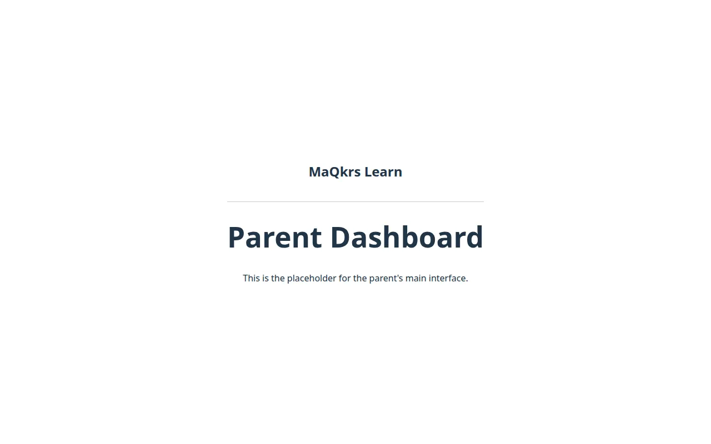

<p align="center">
  <picture>
    <source media="(prefers-color-scheme: dark)" srcset="docs/brand/banner-dark.png">
    
  </picture>
</p>

# GHS Learning Platform

GHS Learning Platform is a schooling portal for families and instructors. This repository is the public source snapshot.

**Status:** Coursework prototype. The API, role checks, and security notes are in the tree. The screens are placeholders, and this repository is not the running site.

Live: https://ghs.nonartificialsi.com · Part of [Andrew Strachan's portfolio](https://www.nonartificialsi.com)

## What it does today

- An Express API exposes a health check, stamps each request with a trace id, and offers an admin-only route that sets a user role after a Firebase JWT check.
- Zod validation on that route rejects missing fields and non-string values. The security tests cover those cases.
- Curriculum schemas describe subjects, units, lessons, and activities.
- The frontend shows a parent placeholder. Teacher and student components are in the source and are not routed.
- Terraform describes a Cloud Storage logging bucket. Threat-model, incident-simulation, and governance notes sit under `docs/`.
- GitHub Actions installs dependencies, builds the API, and uploads an SBOM. The audit step is allowed to fail without failing the job.

## Planned

- Routed teacher and student screens [planned]
- Security headers on the Express API [planned]
- Rate limiting on role changes [planned]

## Screens



Captured from the production preview of this snapshot. No real user data, keys, emails, or tokens appear in it. Teacher and student components are not routed, so they are not shown.

## How it's built

- The API is TypeScript on Express. Firebase Admin reads a service-account JSON string from the environment and checks JWTs.
- The screens are React on Vite. They do not call a model, and they do not receive server credentials.
- `infrastructure/` is Terraform for one logging bucket. Apply it only in a cloud project you control.
- `firebase.json` records a static-host header policy. This repository does not deploy that host.

## Run it locally

```sh
npm install
cp .env.example .env.local   # fill in your own values; never commit them
npm run dev --workspace backend
npm run dev --workspace frontend
```

Run those commands from the repository root. The API listens on port 4000 unless `PORT` is set. It refuses to start without `FIREBASE_SERVICE_ACCOUNT_JSON`, except when `NODE_ENV=test`. The Vite dev server prints its own local URL.

## Tests and checks

```sh
npm test --workspace backend      # 4 tests
npm run build --workspace backend
npm run build --workspace frontend
npm run check
gitleaks dir . --redact
```

`npm run check` runs the claims gate, the emoji gate, and the brand-hotlink gate.

## Security

No secrets are committed. Configuration comes from environment variables listed in `.env.example`. The browser build does not receive the service-account JSON. A full-history secret scan is recorded in `docs/LINEAGE.md` under History rewrite (Andrew). Report a problem to strachan@uab.edu.

## Credits

Author: Andrew Strachan. Built by MaQkrs.

## License

All rights reserved. Source shared for review.
